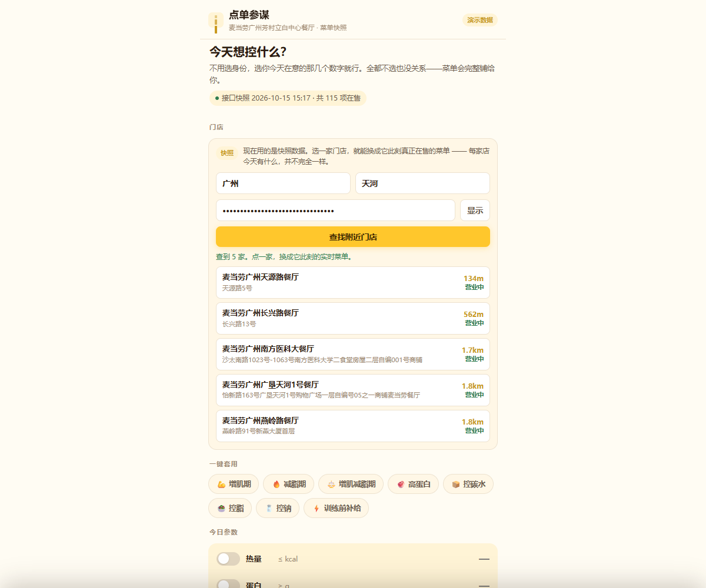
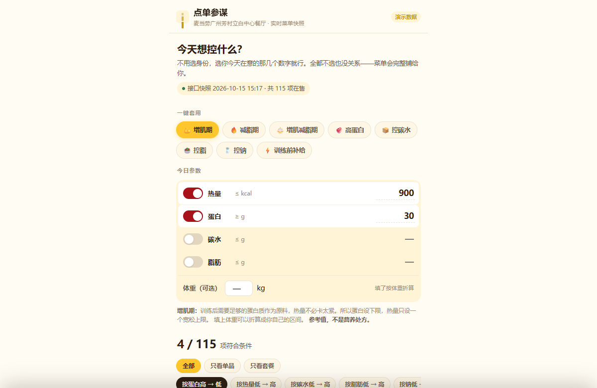
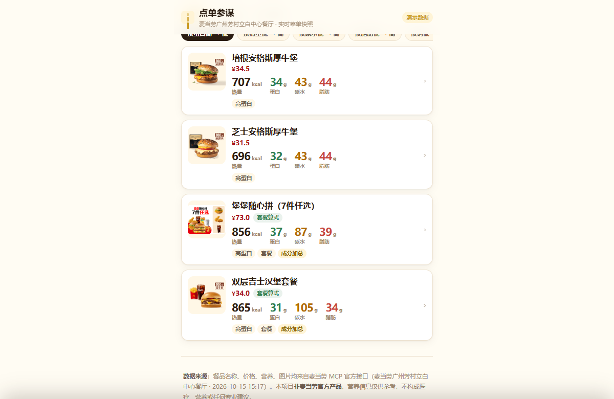
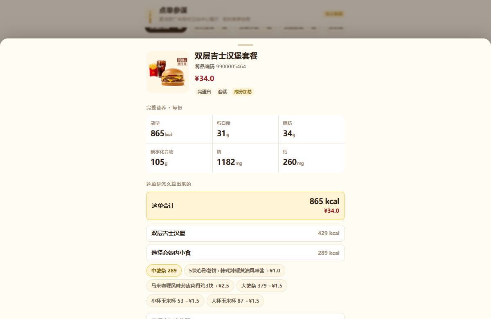
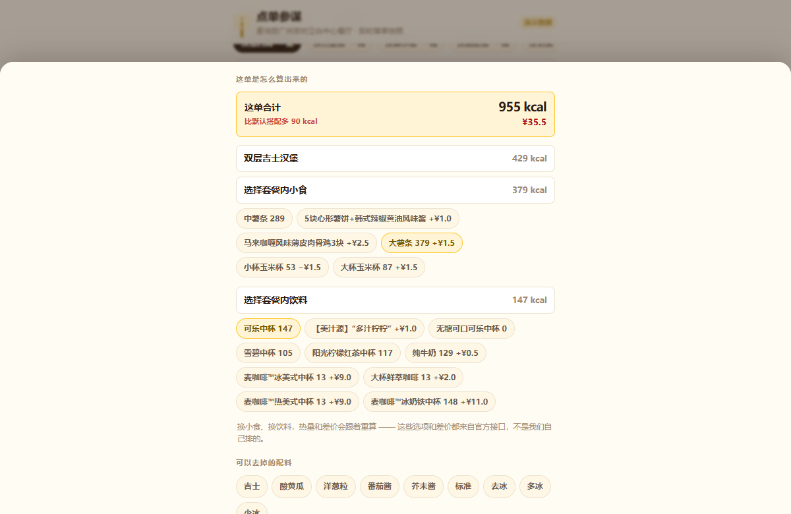
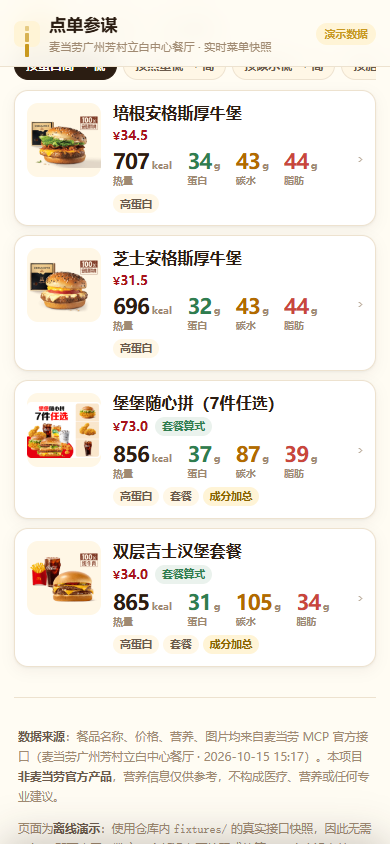
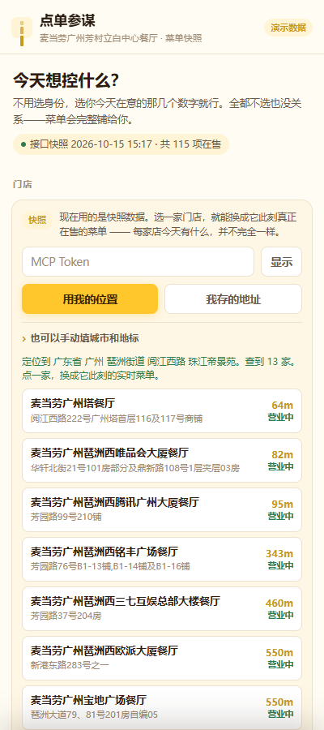
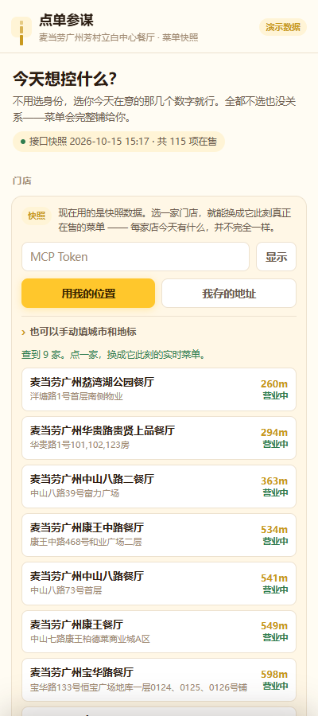
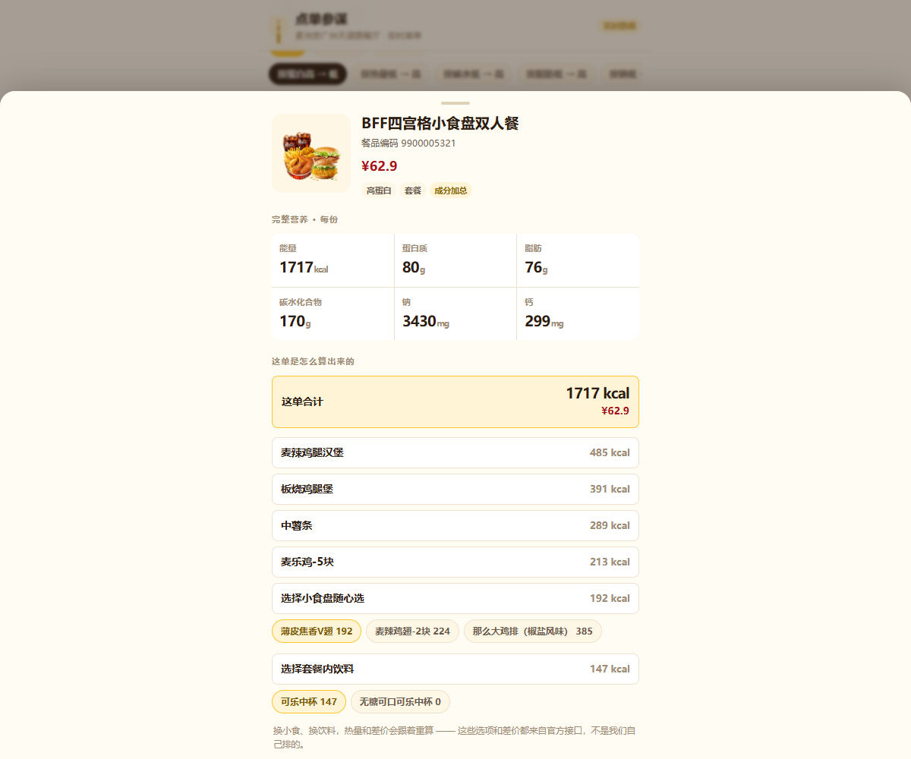
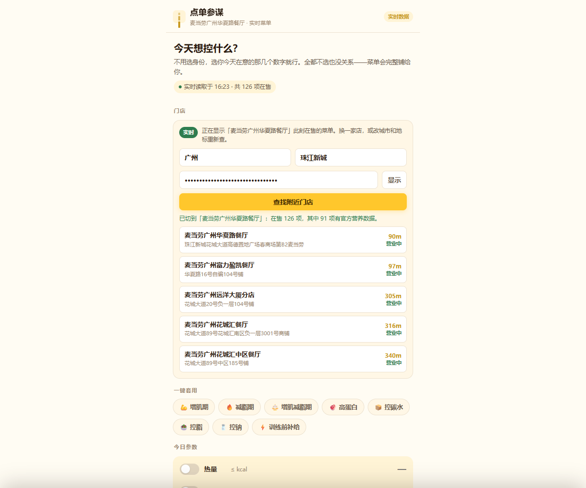

# 点单参谋 · mcd-order-copilot

> 在麦当劳点单前，花 30 秒看清这一顿的**热量 / 蛋白 / 碳水 / 脂肪**。
> 所有数字来自**麦当劳 MCP 官方接口**实时获取 —— 仓库里一个营养值都没有硬编码。

<p>
  
  
  
  
  
  
</p>

<table>
<tr>
<td valign="middle">

**▶ 在线演示：<https://mcd-order-copilot.app.workbuddy.host/>**

无需 Token、无需登录、无需申请任何东西 —— 手机点开就能用：
查你身边的门店，切到它**此刻**真正在售的菜单。

<sub>打不开？备用地址（纯静态快照版，永久可用）：<br><https://26514651.github.io/mcd-order-copilot/></sub>

</td>
<td width="200" align="center" valign="middle">


<sub>**手机扫码即开**</sub>

</td>
</tr>
</table>

> 麦当劳的 MCP Token 只发给报名参赛的开发者，别人拿不到。所以演示页在**服务器端**放了一份共享的**演示额度** ——
> 访客打开就能点。想用自己的额度，或者要用「我存的地址」（那条读的是调用者自己的账号），再填自己的 Token。

<kbd></kbd>

<kbd></kbd>

---

## 30 秒看懂

它只回答三类问题。

| 你会问 | 它给什么 |
|---|---|
| 这一顿到底多少营养？ | 六个字段（能量 / 蛋白 / 脂肪 / 碳水 / 钠 / 钙）直接铺在卡片上，不用点进二级页 |
| 减脂期在这能吃什么？ | 选「减脂期」，自动配好热量上限与蛋白下限，直接列达标项 |
| 套餐把中薯换成大薯，多多少？ | 点一下，**热量和价格同时重算**，并明确告诉你"比默认搭配多 90 kcal" |

它**不做**医疗建议、不做品牌对比、不猜数字。理由写在 [`docs/scope.md`](docs/scope.md)。

---

## 四种打开方式

### 1. 在线演示页（零门槛，手机可开）

打开 **<https://mcd-order-copilot.app.workbuddy.host/>** 即可，不用装任何东西。

页面默认用仓库内 `fixtures/` 的**真实接口快照**，所以**不需要 Token** 就能看到全部功能：在售餐品、8 个目标预设、套餐换配餐重算。快照采集时间与门店写在 [`fixtures/_meta.json`](fixtures/_meta.json)。

**再往前一步：切换成某家门店的实时菜单。**

页面里这**不需要填任何东西** —— 直接点两个按钮之一。演示页在服务器端配了一份共享的**演示额度**，所以没申请过 Token 的人也能用。两种查法都不用打字：

- **用我的位置** —— 浏览器给一个坐标。麦当劳接口本身**不认坐标**（实测：额外塞 `latitude` 字段会被服务端静默忽略），所以后端先用 Photon（OpenStreetMap，免 key）把坐标换成中文地名，再拿地名去查。坐标只送到我们自己的后端，换成地名后即丢弃，两边都不留存。
- **我存的地址** —— 读**你自己**麦当劳账号里存过的收货地址。这一条是唯一必须填自己 Token 的功能：它读的是私密数据，借用演示额度就等于把部署者的家庭地址给每个访客看，后端会直接拒绝（HTTP 403）。
- 两条都不想用，还能展开「手动填城市和地标」。

同一个城市的两家店，在售项数实测就不一样：

| 门店 | 在售 | 有官方营养数据 |
|---|---|---|
| 麦当劳广州天源路餐厅 | 130 项 | 92 项 |
| 麦当劳广州南方医科大餐厅 | 125 项 | 84 项 |

（同一天的实测结果。这也是为什么 `query-meals` 必须传 `storeCode` —— 菜单是**按店**给的。）

> **演示额度不会到你的浏览器里。** 你如果填了自己的 Token，它只存在你这台设备上，随请求经 `X-MCD-Token` 头送到后端、用完即弃，不写进页面、不进 URL、不落盘、不进日志。原理见下面「为什么实时选店必须有个后端」。

### 2. 离线 CLI（零依赖，不用 Token）

只要 Python 3.9+，没有第三方依赖：

```bash
git clone https://github.com/26514651/mcd-order-copilot.git
cd mcd-order-copilot

python run.py --demo                          # 用仓库内真实快照，直接出结果
python run.py --demo --goal cut --weight 70   # 减脂期，按 70kg 折算参考区间
python run.py --demo --kcal 600 --protein 30  # 自定义条件
python run.py --coverage                      # 数据可得性报告
python run.py --list-presets                  # 看 8 个预设
```

```
点单参谋 · 麦当劳营养速查   [离线演示模式]
数据来源：麦当劳广州芳村立白中心餐厅 · 2026-10-15T15:17:26+08:00 快照

💪 增肌期  训练后需要足够的蛋白质作为原料，热量不必卡太紧。所以蛋白设下限，热量只设一个宽松上限。
   数值来源：通用区间（未提供体重）

门店在售 115 项 → 符合条件 4 项
其中 25 项官方暂无营养数据、15 项套餐有组件未收录（合计仅为已知部分之和），均已标注

餐品                           价格      热量     蛋白     碳水     脂肪       钠
────────────────────────────────────────────────────────────────────
堡堡随心拼（7件任选）                73.0     856     37     87     39    1745
培根安格斯厚牛堡                   34.5     707     34     43     44    1037
芝士安格斯厚牛堡                   31.5     696     32     43     44     897
双层吉士汉堡套餐                   34.0     865     31    105     34    1182

数据来自麦当劳 MCP 官方接口 · 本项目非麦当劳官方产品 · 营养信息仅供参考
```

装成包之后也可以用 `mcd-order-copilot --demo` 或 `python -m mcd_order_copilot --demo`：

```bash
pip install -e .
```

### 3. 自己跑一份实时后端

上面那个在线演示页背后就是仓库里的 [`server.py`](server.py)。本地跑一份：

```bash
python run.py --demo                  # 只看 CLI，不需要后端
python server.py                      # 起后端 + 演示页 → http://127.0.0.1:8777
PORT=8080 python server.py            # 发布平台注入的 PORT
```

后端只做这几件事，**全部零依赖**：

| 接口 | 作用 |
|---|---|
| `GET /api/ping` | 页面据此判断有没有后端；没有就自动收起选店表单 |
| `POST /api/stores` | 转发 `query-nearby-stores`，返回附近门店（含距离、营业状态） |
| `POST /api/geo-stores` | **定位**：坐标 → 换成地名（Photon）→ 并发试 3–6 个候选地名 → 合并去重 |
| `POST /api/addresses` | 转发 `delivery-query-addresses`，读账号里已保存的收货地址 |
| `POST /api/stores-by-place` | 同上，地名来自账号里保存的那条地址 |
| `POST /api/store-menu` | 转发 `query-meals` + `query-meal-detail`，返回整店实时菜单 |

**为什么实时选店必须有个后端？** 两个原因是独立成立的，缺一个都还是得加：

1. **麦当劳接口没有任何 CORS 头。** 对 `https://mcp.mcd.cn` 发 `OPTIONS` 预检，返回 **404**、且不带一个 `Access-Control-*` 头 —— 浏览器在 Token 还没派上用场之前就会拒绝这次请求。这是实测结论，不是推断，原始报文在 [`docs/evidence-real.md`](docs/evidence-real.md)。
2. **Token 不能进前端。** 写进 HTML 的东西，任何人「查看源代码」都能拿到。

所以：浏览器 → 我们的后端 → 麦当劳接口。Token 随每次请求走 `X-MCD-Token` 头，用完即弃。

**那演示额度放在哪？** 在后端，永远不会出现在任何 HTTP 响应里。服务器启动时读一份共享 Token（依次找 `--shared-token` 参数、`MCD_MCP_TOKEN` 环境变量、脚本同目录的 `.mcd-token` 文件），匿名访客的请求由它顶上。它只用于**公开数据**接口；`/api/addresses` 永远要求调用者自带 Token。匿名流量按 IP 限流 —— 每人 **10 次/分钟、60 次/天**，全场 200 次/分钟；自带 Token 的访客不受此限。这几条不是洁癖：官方文档写的上限是**整个 Token 每分钟 600 次**，而构建一家店的菜单就要花掉约 **115 次**，不设限的话前五个人就把当天额度吃完了。

几个工程细节：

- **详情并发拉取**。套餐要能加总，就必须逐项拿到 `query-meal-detail`。全量 115 项实测：8 并发 4.77s、**16 并发 2.55s**、24 并发 1.85s。默认取 16 —— 再往上收益递减，且不像正常客户端行为。
- **5 分钟缓存**。菜单短时间内不会变，切店来回点不该重复打接口。缓存键是 Token 的 **sha256 前 12 位**，不是 Token 本身。
- **失败降级**。单个餐品详情拉取失败只跳过它，不会让整份菜单报错；页面拿不到后端就自动回到纯快照模式。

### 4. 接进你的 MCP 客户端

先在 <https://open.mcd.cn/mcp> 申请 Token（手机号登录 → 控制台 → 激活），然后：

```bash
export MCD_MCP_TOKEN="你的Token"      # Windows: set MCD_MCP_TOKEN=...
python run.py --live --city 广州 --goal bulk
```

或按 [`mcp-config.example.json`](mcp-config.example.json) 的格式，把 `mcd-mcp` 配到任意 MCP 客户端里，直接问：

```
帮我看看巨无霸和板烧鸡腿堡的营养，我要增肌
```

---

## 界面

| 参数卡列表 | 套餐详情 |
|---|---|
|  |  |

**换配餐，热量与价格一起重算** —— 这是它和一张静态热量表最大的区别：

<kbd></kbd>

上图这次操作：中薯条（289 kcal，默认）→ 大薯条（379 kcal，+¥1.5）。
合计从 **865 → 955 kcal**，价格 ¥34.0 → ¥35.5，提示「比默认搭配多 90 kcal」。
三个数都对得上：`429 + 379 + 147 = 955`，`379 − 289 = 90`，`34.0 + 1.5 = 35.5`。

手机宽度下同样可用：

<kbd></kbd>

### 实时门店

**先定位，再选店** —— 两条路都不用打字：

| 用我的位置（浏览器给坐标 → 后端换成地名 → 查门店） | 我存的地址（直接读账号里的收货地址） |
|---|---|
| <kbd></kbd> | <kbd></kbd> |

> 实测：在广州塔坐标（23.1066, 113.3245）用「用我的位置」，返回的第一家就是 **麦当劳广州塔餐厅 64 m**。

选店 → 切到这家店此刻的在售菜单。下面是真实时数据：

| 查附近门店 | 实时套餐算式 |
|---|---|
|  |  |

切过去之后整页就是这家店的数据 —— 门店名、读取时刻、在售项数、状态徽标全部跟着变：

<kbd></kbd>

上图这个套餐是**实时拉回来的**：BFF 四宫格小食盘双人餐，合计 1717 kcal，下面逐项列出它是怎么加出来的 ——

```
麦辣鸡腿汉堡 485 + 板烧鸡腿堡 391 + 中薯条 289 + 麦乐鸡 5 块 213
             + 小食盘随心选 192 + 套餐内饮料 147  =  1717 kcal  ✓
```

每一轮还能换成什么、各自多少 kcal、差价多少，也一并列出。

---

## 核心：套餐是一道算式，不是一个数字

`query-meal-detail` 返回的是 `rounds → choices` 结构，所以套餐可以这样理解：

```
双层吉士汉堡套餐  =  双层吉士汉堡 429 kcal
                  +  选择套餐内小食 → 大薯条 379 kcal  (+¥1.5)
                  +  选择套餐内饮料 → 可乐中杯 147 kcal
                  ────────────────────────────────────
                    合计 955 kcal / ¥35.5
```

每轮还有哪些选项、各自多少热量、差价多少，都随接口一起取回，**换配餐在前端本地重算，不用再请求**。

这一步几乎所有人都停在了前面 —— 同期的热量查询类作品里，绝大多数只能报单品。**套餐能算，是这个项目和一张热量表的区别。**

---

## 数字从哪来

核心原则一句话：

> **数字永远是官方的，判断永远是标注过的。**

| 做法 | 说明 |
|---|---|
| **零硬编码** | 代码里没有任何一个营养数值，全部来自接口 |
| **标注来源与时间** | 界面标出「哪家店 · 哪个时刻的快照」 |
| **拿不到就说拿不到** | 官方未收录的餐品显示「官方暂无」，**绝不估算** |
| **不做无依据的差值** | 接口只返回"可去掉哪些配料"，不返回"去掉后少多少" → 所以只列清单，**不算那个值** |
| **不做套餐名称匹配** | `巨无霸三件套` 含巨无霸，但它的热量不是巨无霸的热量 |
| **不覆盖医疗人群** | 没有过敏原数据 → 过敏人群绝不做推荐 |

握手的原始报文、`tools/list` 的 35 个工具、两个真实的解析坑位（响应是"说明文字 + JSON"混合体；`list-nutrition-foods` 返回的是 CSV 字符串而非 JSON 数组），以及一份诚实的"目前做不到什么"清单，都在 **[`docs/evidence-real.md`](docs/evidence-real.md)**。

### 名称匹配：菜单和营养表只能靠名字对齐

两边命名习惯不同 —— 菜单写「可乐」，营养表写「可乐中杯」。逐字精确匹配只覆盖 **30.0%** 的单品：

| 口径 | 单品命中率 |
|---|---|
| 逐字精确匹配（原始 join） | 30.0% |
| 五级级联后 | **48.3%** |

```
L1 精确名称  →  L2 归一化（NFKC 全半角/括号/空格/大小写）
            →  L3 规格推断（可乐 → 可乐中杯）
            →  L4 风味后缀剥离  →  L5 唯一包含
```

**L3 和 L5 是推断，界面会单独标注**，不和精确匹配混在一起。
L5 只在**唯一候选**时才接受 —— 有两个都对得上就返回"没匹配到"。**错的数字比没有数字更糟。**

---

## 数据可得性（诚实版）

对当前快照 `python run.py --coverage` 的真实输出：

```
门店在售          : 115
├ 单品            : 53  → 有官方数据 33（62.3%）
│                       名称表匹配 27 · 套餐明细解析 6
├ 套餐 / 组合      : 61  → 成分加总成功 57 · 结构不可解 4
└ 周边 / 蘸酱      : 1  → 确无营养数据（合理）
```

也就是说，**115 项在售里有 90 项能给出数字**，25 项完全没有数字。其中 90 项里有 15 项是套餐、只拿到了部分组件 —— 界面上把这两种情况分开说：

| 缺口 | 项数 | 界面上怎么说 |
|---|---|---|
| 官方营养表未收录（完全没有数字） | 25 | 「官方暂无这项的营养数据」 |
| 套餐有组件未收录（只有部分数字） | 15 | 标 `*`，并注明「合计仅为已知部分之和」 |

### 已知限制

| # | 限制 | 说明 |
|---|---|---|
| 1 | **没有 GI 值** | 官方字段无升糖指数，所以「控糖」实际只能控**碳水总量**，标签用「控碳水」，不做升糖承诺 |
| 2 | **没有配料级营养** | 拿不到「酱料单独多少千卡」，因此不提供「去酱省 X kcal」这类数字 |
| 3 | **部分新品无营养数据** | 官方营养表暂未收录，显示「暂无」，不参与筛选，**不估算** |
| 4 | **没有过敏原信息** | 官方字段不含过敏原，相关人群以门店信息为准 |
| 5 | **单位口径** | 官方未标注每份 / 每 100g，本项目统一按**每份**展示并在界面注明 |
| 6 | **菜单与价格随门店变** | `query-meals` / `query-meal-detail` 必须传 `storeCode`，不同店结果不同 |

> ⚠️ 本项目**不面向**糖尿病、肾病、孕期、儿童、进食障碍及**食物过敏**人群。以上属于医疗或安全范畴，请咨询医生。我们**不提供**任何医疗建议。

---

## 工程结构

```
mcd-order-copilot/
├── index.html                    # 在线演示页（自包含，含内联快照数据）
├── server.py                     # 实时门店后端（零依赖，含 CORS 说明与缓存）
├── run.py                        # 零安装入口：python run.py --demo
├── pyproject.toml                # 可 pip install，零运行时依赖
├── CONTEST_DECLARATION.md        # 参赛声明（与官方版本一致）
├── MCP_INTEGRATION.md            # MCP 集成说明：工具、调用流程、业务价值
├── mcp-config.example.json       # 脱敏配置示例（只有 ${MCD_MCP_TOKEN} 占位符）
├── workbuddy.md                  # WorkBuddy 联动核验说明
├── src/mcd_order_copilot/
│   ├── mcp_client.py             # MCP 客户端（零依赖，含混合文本解析与退避重试）
│   ├── normalize.py              # 五级级联名称匹配 + 覆盖统计
│   ├── nutrition.py              # 套餐加总、软筛选、标签
│   ├── profiles.py               # 8 个目标预设（五项参数 + 公开依据，非医嘱）
│   ├── payload.py                # 快照与实时共用的 payload 构建（唯一实现）
│   ├── demo_data.py              # 离线 fixtures 加载
│   └── cli.py                    # 命令行入口
├── scripts/
│   ├── sync_fixtures.py          # 复现步骤：只读调用官方接口，落盘快照
│   ├── fetch_images.py           # 餐品图片本地化（多线程、跳过已缓存）
│   └── build_demo.py             # 把快照内联进 index.html
├── fixtures/                     # 真实接口快照（演示数据来源）
├── docs/
│   ├── evidence-real.md          # 真实调用证据 · 两个解析坑位 · 能力缺口清单
│   ├── scope.md                  # 人群边界与合规红线
│   ├── screenshots/              # 界面截图（含实时门店）
│   └── images/                   # 餐品图片（官方 CDN 本地副本）
├── skill/mcd-order-copilot/      # WorkBuddy Skill 封装
└── tests/                        # 62 项单元测试
```

`src/mcd_order_copilot/payload.py` 值得单说：**快照页和实时门店用的是同一份构建代码**。所以离线快照里某个餐品算出什么数，实时模式里同一个餐品就是什么数 —— 两边不可能对不上，因为只有一个"两边"。

---

## 开发与测试

零依赖，纯标准库。跑测试：

```bash
python -m unittest discover -s tests -t . -v      # 62 tests, OK
```

测试守的是三条不变量：

1. **套餐绝不做名称匹配** —— `巨无霸三件套` 不得套用巨无霸的热量
2. **缺失不当 0** —— 某项营养没有数据时，该餐品被筛掉，而不是被当成 0 分
3. **不估算** —— 官方没有的就报「暂无」，`nutrition` 保持为 `None`

快照是**可复现**的，不是手抄的：

```bash
export MCD_MCP_TOKEN="你的Token"
python scripts/sync_fixtures.py --details all   # 只读调用，重新生成 fixtures/
python scripts/build_demo.py                    # 重新生成 index.html
```

---

## 安全与隐私

- 本项目**不会记录或上传**你的 MCP Token。要用环境变量就通过 `MCD_MCP_TOKEN` 注入，不要硬编码或提交到仓库。
- `mcp-config.example.json` 中**不含任何真实 Token**，只有 `${MCD_MCP_TOKEN}` 占位符；`.gitignore` 已排除本地私有配置与 `.mcd-token`。
- **实时门店模式的 Token 处理**，分两条路：
  - 你**自己填**的 Token 只存在**浏览器 localStorage**；每次请求经 `X-MCD-Token` 头送到我们自己的后端，后端用完即弃 —— **不写磁盘、不进日志、不进 URL**，缓存键用的是它的 sha256 前 12 位而非原文。页面不会把它渲染到任何可见位置，也不随分享链接传播。
  - **演示额度**是部署方配在服务器上的一份共享 Token，让没申请过 Token 的访客也能点开就用。它只顶替**公开数据**接口；**`/api/addresses` 永远不借** —— 那个接口读的是调用者自己的收货地址，借用共享凭据等于把部署者的家庭地址展示给每个匿名访客。匿名流量另有 IP 限流（每人 10 次/分钟、60 次/天，全场 200 次/分钟），自带 Token 的访客不受此限。
- 读共享 Token 的顺序是 `--shared-token` → `MCD_MCP_TOKEN` → 脚本同目录 `.mcd-token` 文件；三者都没有时行为回到「访客必须自带 Token」。本地开发想要这个行为，加 `--no-shared-token` 即可。
- 服务端另有目录黑名单（`.git`、`__pycache__`、`*.local.json`、`.mcd-token` 等一律不提供）与请求体上限。
- 涉及**真实下单、积分兑换、抽奖**的写操作工具，本项目**一个都没有调用**。若未来扩展，必须补齐二次确认、幂等、失败核对三道设计（见 [`MCP_INTEGRATION.md` §4](MCP_INTEGRATION.md)）。

---

## 声明

- 本项目为「麦当劳程序员创意开发大赛」参赛作品，由参赛者独立开发，**非麦当劳官方产品**。
- 餐品名称、营养数据、价格、图片均来自麦当劳 MCP 官方接口，仅用于信息展示；实际供应与价格以麦当劳官方渠道实时结果为准。
- 本项目输出的营养信息**仅供参考**，不构成医疗、营养或任何专业建议。
- 代码许可：MIT（详见 [LICENSE](LICENSE)）。

---

<p align="center"><sub>点单前先看数字。看得清，才能选得准。</sub></p>
